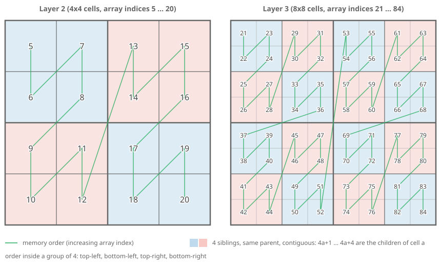
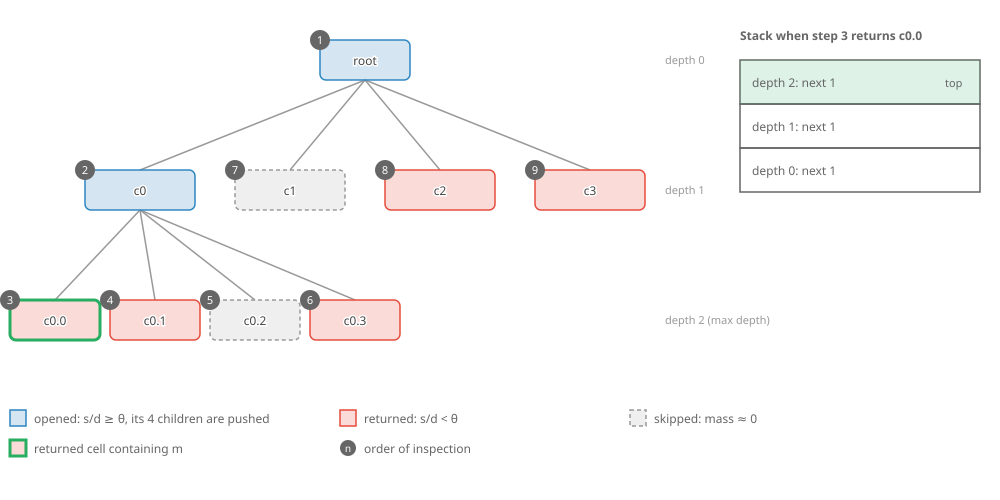
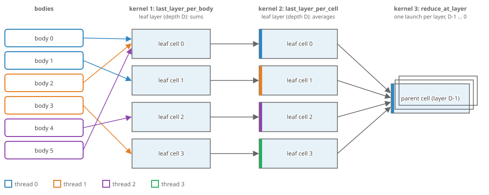

# NBody-rs

**Yuri Andriaccio** \
Scuola Superiore Sant'Anna, Pisa, Italy \
<y.andriaccio@santannapisa.it>

---

# Objectives

The goal of this project is to implement an n-body simulation in CUDA, comparing performance with a single-thread CPU implementation and measuring the achieved speedup of the GPU parallelized approach.

## 🚀 The N-Body problem 🪐

The n-body problem is the problem of predicting the motion of celestial objects interacting with each other gravitationally. Given the massive scales of the universe, the classical problem is simplified in the following form:

> *Each particle in a system of a finite number of particles is subjected to a Newtonian gravitational attraction from all the other particles, and to no other forces. If the initial state of the system is given, how will the particles move? [^1]*

While the two-body problem is solved exactly, the *n*-body problem, with $ n > 2 $, cannot be solved in general (except in specific cases) and must be solved numerically.

[^1]: Rosenberg 1977

## Problem formulation

The *n*-body problem considers *n* point masses $ m_i $ ($ i = 1, 2, ..., n $) in an inertial reference frame in two-dimensional space $ \mathbb{R}^2 $ moving under the influence of mutual gravitational attraction. Newton's second law states that a mass times its acceleration must equal the sum of the forces on the mass, while Newton's law of gravity describes the gravitational force felt on mass $ m_i $ by a single mass $ m_j $.

Given the position vector $ \mathbf{q}_i $ and the velocity vector $ \mathbf{v}_i $ of mass $ m_i $, the following are the *n*-body equations of motion:

$$
m_i \frac{d^2 \mathbf{q}_i}{dt^2} = \displaystyle\sum_{j = 1, j \ne i}^n \frac{G m_i m_j (\mathbf{q}_j - \mathbf{q}_i) }{\left\lVert \mathbf{q}_j - \mathbf{q}_i \right\rVert^3}
$$

or equivalently:

$$
\begin{cases}
\dfrac{d\mathbf{q}_i}{dt} = \mathbf{v}_i \\[1em]
\dfrac{d\mathbf{v}_i}{dt} = \displaystyle\sum_{j = 1, j \ne i}^n \dfrac{G m_j (\mathbf{q}_j - \mathbf{q}_i)}{\left\lVert \mathbf{q}_j - \mathbf{q}_i \right\rVert^3}
\end{cases}
\qquad \forall i = 1, \dots, n
$$

The goal of the problem is, given the initial position and velocity vectors $ \mathbf{q}_i(0) $ and $ \mathbf{v}_i(0) $, to compute $ \mathbf{q}_i(t) $ at time $ t $ for all $ t > 0 $.

# Architecture

This section describes how the n-body simulation is implemented theoretically and practically, with particular focus on emerging problems and adopted solutions.

## Theoretical Approach

There are many ways to approach an n-body simulation. Since the goal of this project is mainly to compare GPU and CPU performance, the following approach was chosen only for aesthetic reasons and its non-triviality.

### Leapfrog Integration

Leapfrog integration is a method for numerically integrating differential equations of the form

$$ \frac{d^2x}{dt^2} = A(x) $$

or equivalently

$$ \frac{dv}{dt} = A(x), \hspace{2em} \frac{dx}{dt} = v $$

which exactly matches the formulation of the *n*-body problem aforementioned.

In leapfrog integration (*kick-drift-kick form*), the equations for updating position and velocity at step $ t $ for mass $ i $ are:

$$
\begin{array}{rcl}
\mathbf{a}_i(t) & = & A(\mathbf{q}_i(t)) \\
\mathbf{v}_i(t + 1/2) & = & \mathbf{v}_i(t) + \frac{1}{2} \mathbf{a}_i(t) \cdot \Delta t \\
\mathbf{q}_i(t + 1) & = & \mathbf{q}_i(t) + \mathbf{v}_i(t + 1/2) \cdot \Delta t \\
\mathbf{a}_i(t + 1) & = & A(\mathbf{q}_i(t + 1)) \\
\mathbf{v}_i(t + 1) & = & \mathbf{v}_i(t + 1/2) + \frac{1}{2} \mathbf{a}_i(t + 1) \cdot \Delta t \\
\end{array}
$$

where

$$
A(\mathbf{q}_i(t)) = \displaystyle\sum_{j = 1, j \ne i}^n \dfrac{G m_j (\mathbf{q}_j(t) - \mathbf{q}_i(t))}{\left\lVert \mathbf{q}_j(t) - \mathbf{q}_i(t) \right\rVert^3}
$$

and $ \Delta t $ is the step size of the integration.

### Barnes-Hut Approximation

The Barnes-Hut simulation is approximation algorithm for *n*-body simulations. While the classic algorithm as stated above needs to compute forces between each possible pair of masses, in complexity terms it has a order $ O(n^2) $, this approximation method reduces the number of mass-force pairs, trading off some simulation quality, ending in a $ O(n \log n) $ complexity.

To achieve such speedup the approximation divides the simulation volume into cells via a quadtree (two-dimensional space), so that only particles from nearby cells need to be treated individually, while particles from distant cells are treated as a single large particle centered at a cell's center of mass (COM).

***Construction***

The quadtree is built by recursively dividing the space into cells and computing the total mass and the center of mass of each cell. A top-down recursive construction builds the first cell, which contains all the masses, then splits the space into four cells and recursively applies the same procedure inside each cell, i.e. it computes the mass-sum and COM of the cell, splits it and repeats. This recursive approach stops when a maximum fixed depth is reached or when a cell contains only one particle mass.

A bottom-up approach for the construction, used in this implementation, instead works from a fixed maximum depth up to the root. The first step builds the last layer, computing COMs and mass-sums for each cell. Following steps simply aggregate the masses of the four child cells of each node.

***Force Approximation***

Once the quadtree is built, it is used in the computation of the forces acting on a specific mass, previously labelled $ A(\mathbf{q}_i(t)) $, by substituting the sum over all masses with a sum over masses mixed with aggregation cells.

Let mass $ m_i $ be the mass considered for the force computation. The set of particle masses and quadtree nodes used in the interaction is determined by the quotient between the width $ s $ of a region and its distance $ d $ from body $ m_i $. If a node is sufficiently far away, i.e. its size-distance ratio $ s/d $ is smaller than a given threshold value $ \theta $, then the node's COM and mass-sum are considered as a whole. If the node is too close, the inner nodes are checked individually with the same size-over-distance approach, or, if the maximum depth of the tree is reached, their component masses are individually involved.

<svg xmlns="http://www.w3.org/2000/svg" viewBox="0 0 800 420" width="800" height="420" font-family="sans-serif" font-size="13"><g transform="translate(10 10)"><g fill="#e74c3c" fill-opacity="0.15"><rect x="0" y="0" width="200" height="200"/><rect x="200" y="0" width="200" height="200"/><rect x="200" y="200" width="200" height="200"/></g><rect x="0" y="200" width="200" height="200" fill="#2e86c1" fill-opacity="0.15"/><rect x="0" y="0" width="400" height="400" fill="none" stroke="#666" stroke-width="2"/><g stroke="#666" stroke-width="1.5"><line x1="200" y1="0" x2="200" y2="400"/><line x1="0" y1="200" x2="400" y2="200"/></g><g stroke="#666" stroke-width="1" stroke-dasharray="4 3"><line x1="100" y1="200" x2="100" y2="400"/><line x1="0" y1="300" x2="200" y2="300"/></g><g stroke="#e74c3c" stroke-width="1.5"><line x1="150" y1="250" x2="50" y2="50"/><line x1="150" y1="250" x2="340" y2="90"/><line x1="150" y1="250" x2="350" y2="350"/></g><g stroke="#2e86c1" stroke-width="1.5"><line x1="150" y1="250" x2="60" y2="260"/><line x1="150" y1="250" x2="90" y2="330"/><line x1="150" y1="250" x2="170" y2="340"/></g><g fill="#999"><circle cx="30" cy="30" r="3"/><circle cx="70" cy="70" r="3"/><circle cx="310" cy="50" r="3"/><circle cx="370" cy="130" r="3"/><circle cx="330" cy="330" r="3"/><circle cx="370" cy="370" r="3"/></g><g stroke="#e74c3c" stroke-width="3"><path d="M44 44 l12 12 M56 44 l-12 12"/><path d="M334 84 l12 12 M346 84 l-12 12"/><path d="M344 344 l12 12 M356 344 l-12 12"/></g><g fill="#2e86c1"><circle cx="60" cy="260" r="5"/><circle cx="90" cy="330" r="5"/><circle cx="170" cy="340" r="5"/></g><circle cx="150" cy="250" r="8" fill="#27ae60" stroke="#1e8449" stroke-width="2"/></g><g transform="translate(460 40)" fill="#666"><circle cx="8" cy="0" r="8" fill="#27ae60" stroke="#1e8449" stroke-width="2"/><text x="28" y="5">target mass m<tspan dy="4" font-size="10">i</tspan></text><rect x="0" y="40" width="16" height="16" fill="#e74c3c" fill-opacity="0.25" stroke="#e74c3c"/><text x="28" y="53">node with s/d &lt; &#952;</text><path d="M2 82 l12 12 M14 82 l-12 12" stroke="#e74c3c" stroke-width="3"/><text x="28" y="93">used as one mass at its COM</text><rect x="0" y="120" width="16" height="16" fill="#2e86c1" fill-opacity="0.25" stroke="#2e86c1"/><text x="28" y="133">node with s/d &#8805; &#952;: opened</text><circle cx="8" cy="168" r="5" fill="#2e86c1"/><text x="28" y="173">individual mass</text><text x="0" y="220">s: node width</text><text x="0" y="242">d: distance from the target to the node COM</text><text x="0" y="264">&#952; = 0.9</text></g></svg>

## Implementation Details

This *n*-body simulator is implemented in the Rust programming language, while CUDA specific code is implemented in CUDA-C++, compiled with the NVIDIA compiler and linked together with the Rust binary. The skeleton of the simulator is the simulator `trait` (Java/C++ interface), which defines the API of the simulator.

The simulator API requires implementors to provide ways to create and reset a simulation, defining its initial state and parameters, step the simulation and pull updates whenever one or (many) more steps are performed.

The parameters of the bodies are their *mass*, *position* and *velocity*, while the simulation is parameterized over the size of the *time step*, and the values of the $ \theta $ and the $ G $ gravitational constants.

The simulation is additionally integrated with a rendering pipeline, which displays the state of the system in real-time while this is updated and also allows to visually inspect the outputs of the quadtree generation and computed forces.

### CPU Simulation

The CPU simulation code is a straightforward implementation of the Leapfrog and Barnes-Hut methods described in the theoretical section.

**Quadtree construction**

The quadtree is built top-down by iterating over all bodies for each layer. Bodies that fall in the same cell at each layer are aggregated togheter. Internally, the quadtree is defined as a single contiguous array of cells containing all the layers appended one after the other. Given the position of a cell and its depth, it is always possible to find its siblings, its parents and its children positions in this array by simple mathematical computations:

Each layer at depth $ d $ starts at $ \sum_{k=0}^{d-1} 4^k $ and is composed of $ 4^d $ cells. The four children of a given cell at index $ i $ are indices $ \{ 4i+1, 4i+2, 4i+3, 4i+4 \} $, while its parent is at index $ \lfloor (i-1)/4 \rfloor $. This layout is different from having all the cells aligned in rows and can potentially improve cache locality because cells that are checked together are close in memory.

**Quadtree iteration**

Another interesting routine is the quadtree iteration: given the quadtree, the $ \theta $ parameter and the position of a mass $ m_i $, the iterator scans the tree structure and returns, one by one, the cells that are to be used by the routine that computes interaction forces. The total complexity of the single iteration per mass is $ O(\log n) $.

The iteration is depth-first and keeps a stack of the next cells to visit. At each iteration step it is decided if the top cell of the stack must be visited as is, because it is further than the threshold distance, or if its 4 children are of interest. In the second case the children are pushed onto the stack and the recursive visit restarts.

**Simulation step**

The simulation step proceeds as described in the theoretical section: The quadtree of masses is built, used to compute the first *kick* step of the Leapfrog integration, then the *drift* step is performed. Before the second *kick* step the quadtree is recomputed on the updated positions.

### CUDA Simulation

The CUDA code is very similar in theory to that of the CPU simulator, but it has important differences in some key places to allow distributing the workload over all the Streaming Multiprocessors (SM).

**Quadtree**

Quadtrees in the CUDA section have the same memory layout as in the CPU code, but their construction and access is optimized for the GPU code. Here, the quadtree is built bottom-up, aggregating first the masses at the layer with the smallest size and then building the layers one by one from the cell's children data.

The last layer is built in parallel by splitting all the bodies evenly across all available threads. An atomic addition is necessary because each thread needs to access regions of memory which may have contention. The remainder of tree building is split in multiple parts: First, when $ 2^n $ threads are active, the layers from $ n $ to the maximum depth are subdivided equally amongst all $ n $ threads; Each thread is assigned a specific cell at layer depth $ n $ and its whole subtree and can compute it in isolation. Layers from $ n $ to $ 0 $ must be instead merged; Each cell at layer $ k $ is assigned to only one of the threads and the remainder $ 2^n - k $ threads stay idle. Each layer is additionally synchronized before starting reducing the next layer. This reduction procedure continues until the root is reached.

Quadtree iteration is performed exactly as in the CPU case, but, being the visits independent from each other, it is possible (and will be the case) to perform multiple iterations concurrently.

**Simulation step**

The following is the description of the *kick-drift-kick* iterations for the CUDA solution. After computing the quadtree for the first *kick* step, bodies are split equally between CUDA threads and are iterated in parallel to compute their respective interaction forces. The *kick* step is then performed and synchronized, to then perform the *drift* step and after re-computing the quadtree, the second *kick* step is performed. Since the Leapfrog integration needs cross-body information only to compute interaction-forces, velocity and position updates can be performed independently.

### Rendering Pipeline

The author of this project was not satisfied with the implementations aforementioned and decided to over-engineer the simple idea by also introducing a rendering frontend which displays the in-flight simulation. The visualization is written in Rust using the [Bevy](https://bevy.org/) library.

While there are many details irrelevant for the project itself, this implementation uses an asynchronous middleware which creates a separate thread in charge of the simulation, while the main process is in charge of creating a visualization. The simulator and renderer execute separately, so that a bottleneck in one does not directly stall the other: the renderer pulls updates from the simulation backend only when it refreshes the visualization.

# Results

---

**NBody-rs**
